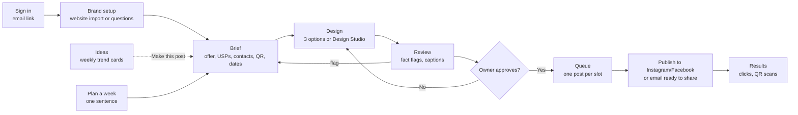
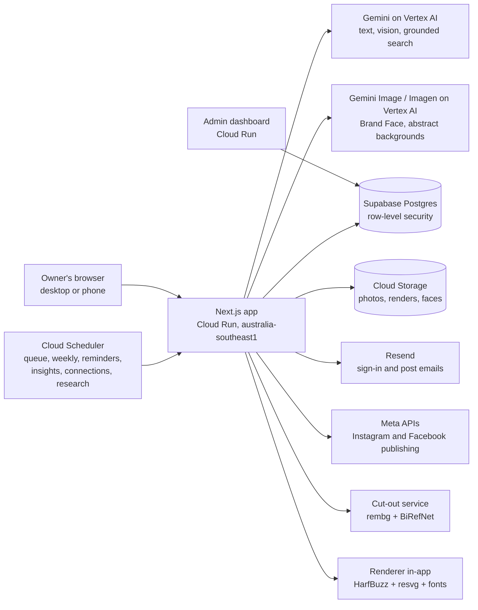

# Pitch content: Weekly Posts

Content for the owner's deck template, slide by slide, in the template's order. Each slide has: visible text (about 60 words or fewer), a speaker note, and a suggested visual. Facts come from our docs and code; gaps are marked.

Markers:
- **[OWNER TO FILL]**: team fields only the owner knows.
- **[NEEDS SOURCE]**: a number we do not have from a cited source. Do not fill it with a guess.
- **[OWNER TO DECIDE]**: a choice not made in our docs.
- **[ESTIMATE]** / **[TO MEASURE]**: not measured yet.

Sources: `docs/1-5` (research), `docs/6-prd-v3.md`, `docs/HANDOFF.md`, `docs/10`, `docs/12`, `docs/13`, `docs/deploy.md`, `CLAUDE.md`, and the code (`src/lib/ai`, `src/lib/faces`, `src/lib/ideas`, `src/lib/usage/caps.ts`).

---

## Slide 1. Team details

**Visible text**
- Team name: zerochills
- Team leader: [OWNER TO FILL]
- Problem statement: Small business owners need regular, good-looking, truthful posts, but have no design skills, time or budget. Generic AI tools invent facts and garble local-language text.

**Speaker note:** We are building for the owner of a small shop or service who knows their business but not design.

**Visual:** Product name and logo; the Tween guide character beside it.

---

## Slide 2. (Template instructions slide; skip, will be removed)

---

## Slide 3. Brief about the idea

**Visible text**
**Weekly Posts: details first, then design.**
- The owner fills a short brief: offer, selling points, contacts, QR, dates.
- AI drafts captions and ideas; code draws every word, logo and QR.
- Posts state only facts from the brief.
- The owner approves; posts are scheduled and published one at a time.

**Speaker note:** The order matters: we lock down what is true before anything is designed, so the post can never claim something the owner did not say.

**Visual:** Two-step strip: "Details" form on the left, finished post on the right.

---

## Slide 4. Opportunities

**Visible text**

| | Canva | Buffer / Hootsuite | Predis / Ocoya-type AI | Freelancer / agency | **Weekly Posts** |
|---|---|---|---|---|---|
| Facts only from owner | No | No | No | Depends | **Yes, checked** |
| Code-drawn text and QR | Manual | No design | AI design | Manual | **Yes** |
| Approval before publish | n/a | Yes | Yes | Yes | **Yes** |
| Brand Face | No | No | No | Costly | **Yes** |
| Cost | Free/paid | Paid (USD) | ~$29-59/mo | Rs 15K-50K/mo | [OWNER TO DECIDE] |

Problem size: [NEEDS SOURCE]

**Speaker note:** Each tool covers one piece; nobody combines brief-first facts, code-drawn text and a consistent brand face for small businesses (Stage 3 research). Market size is still unsourced in our docs.

**Visual:** The table, with our column highlighted.

**Backing facts for this slide (not all visible):**
- Predis.ai / Ocoya-type generators: about $29-59 a month, USD pricing, limited vernacular (G2 alternatives listing; `docs/3-solutions.md` SOL-6).
- Freelance social media manager in India: about Rs 15K-50K a month (upGrowth and SoloHourly pricing guides; SOL-3).
- Buffer, Hootsuite (OwlyWriter), Later, SocialBee: mature, generic, English-first (SOL-8).
- Canva templates and Magic Switch: DIY design with translation; brand-kit language behaviour unclear (SmartCompany; SOL-5).
- Other alternatives in our docs: Indian-language AI writers (Quillmo Rs 599/mo per Capterra, Likho, SocioMee; SOL-7), approval tools (Planable, SocialPilot; SOL-13), n8n/Zapier pipelines (SOL-12), brand-supplied WhatsApp creatives for kirana shops (Kirana Club case study; SOL-4).
- Research caveat (`docs/3-solutions.md`): most sources are vendor blogs; pain points are desk hypotheses not yet validated with users (`docs/1-user-stories.md` C-5).
- AI image models misspell Hindi and regional scripts (`docs/5-challenge.md`), which is why we draw all text with code.
- Market size (number of small businesses, social-media spend): **[NEEDS SOURCE]**. No figure in our docs.
- Willingness to pay "likely Rs 199-499/month, if anything" is our own hypothesis (`docs/5-challenge.md`), not a sourced number.

**USP lines (if the template wants them separately):**
1. Details first, then design.
2. Facts only from the brief; anything else is flagged "please check".
3. Approval before anything is published.
4. Text, logos and QR drawn by code; a payment QR must scan back to the exact saved ID.
5. Brand Face: one consistent character, made once and reused at no extra cost.
6. Built for Indian and global small businesses: posts in 20+ languages, any currency, every time zone.

---

## Slide 5. Features (built and working)

**Visible text**
- Create a post: details, "On the post", 3 design options, review, schedule
- Design Studio: drag, resize, inline text, add contacts/QR, photo blend and cut-out
- Plan a week from one sentence of offers
- Carousels (3-10 slides)
- 13 code-drawn characters, 41 actions
- Brand Face (4 kinds), price approved first
- Ideas: weekly grounded trend research
- Queue, Meta publishing, admin dashboard

**Speaker note:** Everything listed is live on the deployed app today. Reels show as "Coming soon".

**Visual:** 2x4 icon grid, one icon per feature.

**Backing facts:** `docs/HANDOFF.md` "Built" and "New on 2026-10-16"; `docs/13-design-studio-and-weekly-plans.md`. Live revision 00008 (2026-10-16) does not include carousels, Design Studio or Plan a week. Meta publishing works for app testers; public use waits on Meta App Review. Post results (insights) job is built but waits on Meta permissions.

---

## Slide 6. Process flow

**Visible text**
1. Sign in by email link
2. Set up brand (import website or answer short questions)
3. Write the brief: offer, selling points, contacts, QR, dates
4. Pick and edit a design
5. Review: fact flags, captions
6. Approve and schedule
7. Published (or emailed, ready to share)
8. Results: clicks and QR scans

**Speaker note:** The same path serves a single post or a whole week from one sentence; nothing goes out without step 6.

**Visual:** The Mermaid flowchart below.

---

## Slide 7. Wireframes / mock diagrams (optional)

**Visible text:** Real screens, not mock-ups: Create (details), Design Studio, Review, Schedule calendar, Ideas, Brand Face card.

**Speaker note:** We show the working app rather than wireframes.

**Visual / screens to screenshot:** `/create` (details step), `/create/[id]/design` (Design Studio), Review screen, Schedule calendar, `/ideas`, `/brand` (Face card). The approved design prototype is `docs/design/prototype-fish-theme.html` if a mock is wanted.

---

## Slide 8. Architecture

**Visible text:** Browser → Next.js on Cloud Run → Gemini and Imagen on Vertex AI, Supabase Postgres with row-level security, Cloud Storage. Cloud Scheduler runs the jobs; Resend sends email; Meta APIs publish.

**Speaker note:** One Next.js app on Cloud Run does everything; all text and QR codes are rendered on the server by code, and AI never touches payment IDs.

**Visual:** The Mermaid diagram below.

---

## Slide 9. Technologies used

**Visible text**
- Next.js (App Router, TypeScript)
- Google Cloud: Cloud Run, Cloud Scheduler, Cloud Storage, Cloud Build, Secret Manager
- Vertex AI: Gemini (gemini-3.8-flash), Gemini 3.1 Flash Image, Imagen 4, Google Search grounding
- Supabase Postgres with row-level security
- HarfBuzz + resvg, open-licence fonts (Noto and others)
- Resend email; Meta Graph API

**Speaker note:** Gemini does the language work; code does every pixel of text, so Hindi and other scripts render correctly.

**Visual:** Logo wall grouped as "Google Cloud", "Data", "Rendering", "Integrations".

---

## Slide 10. Estimated implementation cost (optional)

**Visible text**

| Item | Cost |
|---|---|
| AI per brand per week (posts, captions, checks) | capped at $0.50 |
| One post's copy (Gemini) | about $0.01 |
| Abstract background (Imagen 4) | about $0.04-0.05 |
| Ideas research | about $0.33, capped $0.50/brand/week |
| Brand Face (once) | about $1.32, cap $2, owner approves first |
| Face in each post | $0 |
| Cloud Run + Supabase per month | [ESTIMATE] |

**Speaker note:** Every AI run over $0.50 needs the owner's approval first, and every brand has a weekly cap enforced in code.

**Visual:** The table.

**Backing facts:** `src/lib/usage/caps.ts` (WEEKLY_USD_CAP 0.5; post_copy estimate 0.01; image estimate 0.05), `src/lib/ai/imagen-price.ts` (Imagen 4 about $0.04 per image), `docs/10` (research about $0.33; cap $0.50), `docs/HANDOFF.md` and `src/lib/faces/generate/estimate.ts` (face about $1.32; FACE_CAP_USD 2.0). A ₹450/month budget alert is set on the Cloud project (`docs/deploy.md`); that is an alert, not a measured cost.

---

## Slide 11. Snapshots of the prototype

**Visible text:** 4-6 screenshots with one-line captions.

**Speaker note:** These are screenshots of the running app.

**Screens to capture:**
1. **Create, details step:** "The owner says what is true first: offer, selling points, contacts, QR, dates."
2. **Design Studio:** "Live editing; every word, logo and QR is drawn by code."
3. **Review:** "Anything not in the brief is flagged 'please check' before approval."
4. **Schedule calendar:** "Approved posts go out one at a time, at the owner's chosen slot."
5. **Ideas:** "Weekly trend cards with dated sources, and 'Make this post'."
6. **Brand Face card:** "One consistent face; the price is shown and approved first."

---

## Slide 12. Prototype performance report / benchmarking

**Visible text**
- About 4,611 automated tests passing
- TypeScript and lint clean
- Row-level security on 49 of 49 tables
- AI cost caps enforced in code
- Fact guardrail: code + AI check of prices, dates, contacts, ratings
- Payment QR must decode to the exact saved ID, or the post is blocked
- First post time, render speed: [TO MEASURE]

**Speaker note:** These are measured from the codebase; user-facing timings against the PRD targets (first post under 5 minutes, render under 1.5 s) are still to be measured.

**Visual:** Six stat tiles.

**Backing facts:** test count, tsc/lint and RLS figures as reported by the orchestrator's latest run (full suite on 2026-10-18: 4,611 passed, 5 skipped). PRD v3 targets not yet measured: Path B post in under 5 minutes, 3 design options in under 15 s, a render under 1.5 s, planted false facts flagged at least 95% of the time: all [TO MEASURE].

---

## Slide 13. Additional details / future development

**Visible text**
- Reels and short videos (Veo), opt-in and priced first
- Post results from Instagram and Facebook insights (waiting on Meta App Review)
- YouTube Shorts, Google Business Profile, LinkedIn
- WhatsApp delivery
- Growth report and category benchmarks (BigQuery)
- Agency workspace for many brands
- Business model: [OWNER TO DECIDE]

**Speaker note:** The next steps reuse the same engine; pricing is open, and our docs say the pilot is free.

**Visual:** Timeline: Now / Next / Later.

**Backing facts:** `docs/6-prd-v3.md` §5.5 and §8; `docs/10` R-8 to R-10; `docs/5-challenge.md` (monetisation through brands, distributors or agencies is future scope); `docs/6-prd-v2.md` ("Paid plans, billing: Future; pilot is free").

---

## Slide 14. Links

**Visible text**
- GitHub (public): [OWNER TO FILL] (the current repo is private)
- Demo video (3 minutes): [OWNER TO FILL]
- Live product: https://weekly-posts-526531409571.australia-southeast1.run.app

**Speaker note:** The live link is the deployed app, with every feature above live, including Design Studio, Plan a week and carousels.

**Visual:** QR code for the live link (drawn by code), plus the three links.

---

## Responsible AI rules (use where the template allows, e.g. slide 4 or 13)

From `CLAUDE.md`:
- AI images only as abstract backgrounds; never the owner's products, premises or people.
- One exception: an owner-approved Brand Face, made once and reused. Never a real or famous person; realistic faces always labelled "AI"; never for health or finance brands; never shown as a professional, customer or in a testimonial.
- No text inside AI images; all text, logos and QR codes drawn by code.
- Posts state only facts from the brief or profile; anything else is flagged "please check".
- Payment IDs are typed by the owner, confirmed by email, and never sent to AI.
- Nothing is published without the owner's approval.
- Row-level security on every table; publishing tokens encrypted at rest.
